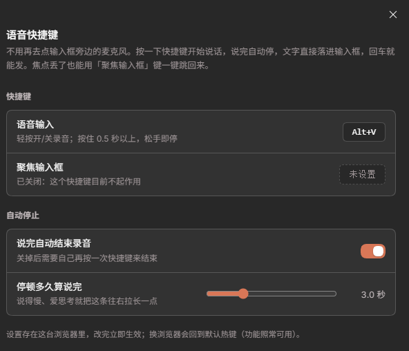

# dsh-voice-hotkey 🎤

<p align="center">
  <a href="https://www.npmjs.com/package/dsh-voice-hotkey"></a>
  <a href="https://www.npmjs.com/package/dsh-voice-hotkey"></a>
  <a href="https://github.com/whiplashf/dsh-voice-hotkey/blob/main/LICENSE"></a>
  
</p>

<p align="center">
  <b>Alt+V, speak, silence stops it, Enter sends.</b><br>
  No mouse, no clicking the little microphone.
</p>

<p align="center">
  
</p>

## Install

```bash
dsh plugin --profile web add dsh-voice-hotkey    # from npm; use desktop for the Electron app
```

Or type `dsh-voice-hotkey` into the install box on the **Plugins** page. Restart DSH afterwards.

> Requires the official **Voice Input** bundle (it downloads the ~231 MB SenseVoice model on first use). This plugin is its remote control.

## Use

| Keys | What it does |
| --- | --- |
| `Alt + V` | start / stop. Short tap toggles, **hold 0.5 s and release** = stop on release |
| `Ctrl + Alt + I` | focus the composer (dsh has no such command; can be disabled) |
| `Esc` | cancel a take while recording; in settings, clears that hotkey |

Two seconds of silence ends the take, the text lands in the composer with focus intact, Enter sends.

## Settings

**Settings → Voice hotkey** (the screenshot above): both hotkeys are re-recordable and clearable, the silence threshold is 0.5–10 s and auto-stop can be turned off. Stored in this browser's `localStorage`.

## Notes

- Recording, transcription and writing the draft stay the official plugin's job — this one just clicks its buttons, so official upgrades rarely break it.
- **Zero dependencies, zero extra network requests.** Audio still goes through the official path to your own dsh server.
- No live captions (the official transcription is one-shot); homophones happen — skim before sending.
- Works in dsh web and the desktop app (Electron).

More detail: [docs/DETAIL.md](docs/DETAIL.md).

## License

MIT © whiplashf

[中文](README.md)
