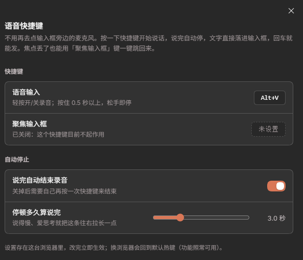

# dsh-voice-hotkey 🎤

<p align="center">
  <a href="https://www.npmjs.com/package/dsh-voice-hotkey"></a>
  <a href="https://www.npmjs.com/package/dsh-voice-hotkey"></a>
  <a href="https://github.com/whiplashf/dsh-voice-hotkey/blob/main/LICENSE"></a>
  
</p>

<p align="center">
  <b>Alt+V 说话 → 停顿自动停 → 回车发送。</b><br>
  不碰鼠标，不用点那个小话筒。
</p>

<p align="center">
  
</p>

## 安装

```bash
dsh plugin --profile web add dsh-voice-hotkey    # 从 npm 装；桌面版换成 desktop
```

或者在**插件管理**页的安装框里填 `dsh-voice-hotkey`，点安装。装完重启 DSH。

> 前置：官方「语音输入」Bundle 已启用（首次会下载约 231 MB 的 SenseVoice 模型）。本插件是它的遥控器。

## 用法

| 按键 | 作用 |
| --- | --- |
| `Alt + V` | 开始 / 停止录音。短按是开关，**按住 0.5 秒以上再松手** = 说完即停 |
| `Ctrl + Alt + I` | 把焦点放进输入框（DSH 本身没有这个命令，可关掉） |
| `Esc` | 录制中取消一次；在设置里按 `Esc` 则清空该热键 |

说完话**安静 2 秒**就会自动结束并转写，字直接落进输入框，焦点还在，回车就发。

## 设置

**设置 → 语音快捷键**（就是上面那张图）：两个热键都能重录或关掉，自动停的停顿时长 0.5–10 秒可调，也能整个关掉改手动。设置存在当前浏览器的 `localStorage` 里。

## 说明

- 录音、转写、写回草稿都是官方插件的活，本插件只替你去点它的按钮 —— 所以官方升级不容易把它弄坏。
- **零依赖、零新增网络请求**。音频仍走官方链路到你自己的 dsh 服务器。
- 不支持边说边出字（官方转写是一次性的）；同音字会错，发前扫一眼。
- dsh web 与桌面版（Electron）都能用。

更细的实现与边界见 [docs/DETAIL.md](docs/DETAIL.md)。

## 许可

MIT © whiplashf

[English](README.en.md)
